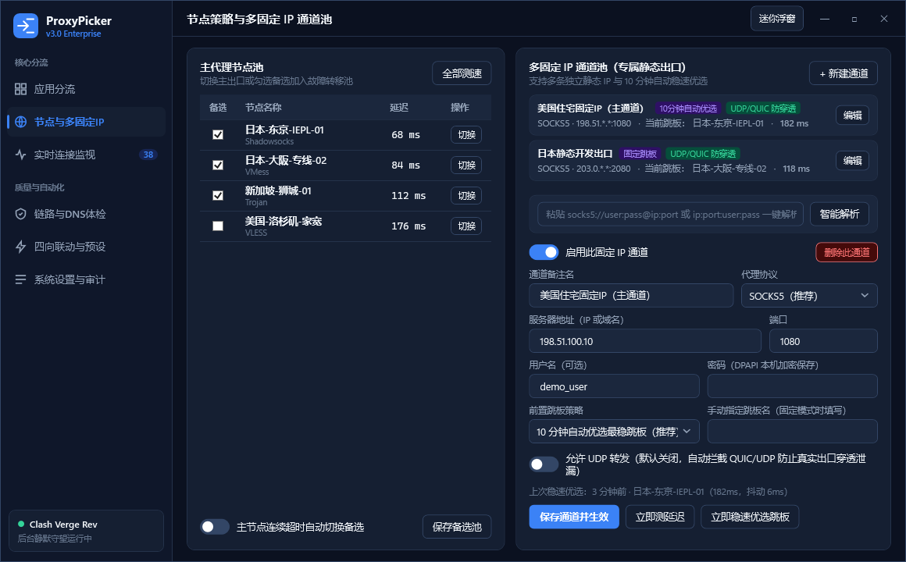
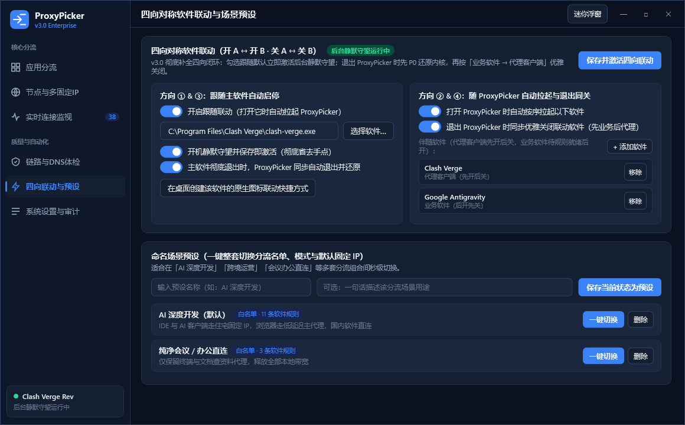

# ProxyPicker

> **企业级 Windows 桌面按进程分流与多通道控制工作台** —— 专为 Clash / mihomo 系代理客户端打造。

单文件绿色便携 exe，**1,246,232 字节（约 1,217 KB）**，原生 WPF Fluent 双主题界面，免安装、免额外运行库（Win10/11 原生 `.NET Framework 4.8`）、不修改机场订阅源文件，100% 向下无损兼容迁移 `v2.x` 配置与 DPAPI 加密固定 IP 保险箱。

[**下载最新版 (v3.0.0)**](https://github.com/wuerchenai-cell/ProxyPicker/releases/latest) ·
[直接下载 ProxyPicker.exe](https://github.com/wuerchenai-cell/ProxyPicker/releases/latest/download/ProxyPicker.exe) ·
[完整更新日志](CHANGELOG.md) ·
[详细使用说明](docs/使用说明.md)

---

> ### 🚀 v3.0.0 企业级全系统重构（2026-11-26）
> 从 Demo 迭代形态彻底重构为严谨的企业级五层单向架构（`Domain` / `Platform.Windows` / `Infrastructure` / `Application` / `App` + 独立 `Tests` 工程），构建仍打包为**真正单文件绿色便携 `ProxyPicker.exe`**：
> 1. **内核并发控制中枢（`KernelCoordinator` + `PowerResumeGuard`）**：全系统唯一串行写队列（`P0` 退出还原 → `P4` 后台优选）+ `ConfigRevision` 乐观锁 CAS 彻底终结数据竞争；系统休眠唤醒与墙钟跳变自动进入 12 秒静默宽限期防风暴。
> 2. **原生 WPF MVVM 双主题企业工作台**：深色 / 浅色 / 跟随 Windows 系统主题即时热切换，100%–150%+ 高 DPI 全矢量清晰渲染，6 大一级工作区 + 紧凑迷你监控浮窗。
> 3. **应用分流三态直切 + 实时连接白盒监视器**：软件表支持 `[ 直连 | 主代理 | 固定IP ]` 一键直切，配合三色实时矢量走势曲线与实时连接监视器（错路旧连接红标高亮、一键断开单条或全部错路连接）。
> 4. **多固定 IP 通道池 + 10 分钟稳态优选 + UDP/QUIC 防穿透**：支持配置多条独立住宅/静态 IP 通道（默认通道完全兼容 `PP-STATIC-OUT`/`PP-STATIC-HOP`），旁路 16 路初筛 + Top 5 三次复核稳态优选跳板，默认封堵 UDP/QUIC 穿透。
> 5. **真正四向对称软件联动 + 命名场景预设**：彻底补全「开 A↔开 B、关 A↔关 B」四向闭环——勾选跟随默认自动激活后台守望保存即生效；退出 ProxyPicker 先经 `P0` 队列干净还原内核，再按「业务软件 → 代理客户端」优雅关闭；支持命名场景预设一键切换。
> 6. **DNS 防泄漏只读体检 + 跨机加密配置迁移**：新增只读 DNS/TUN 体检建议、零干扰旁路节点四门风控评估（Google / Gemini / OpenAI / Claude），以及 `PBKDF2-SHA256 + AES-256-CBC + HMAC-SHA256` 认证加密配置迁移包导入导出。


---

## 六大核心工作区

| 工作区 | 核心能力 |
|---|---|
| **1. 应用分流** | 顶部双独立延迟仪表卡 + 三色实时吞吐曲线；软件表 `[直连 \| 主代理 \| 固定IP]` 一键直切；支持白名单 / 订阅兼容双模式，保存仅定向断连变动软件 |
| **2. 节点与多固定IP** | 主策略组并发测速、一键切节点、故障转移备选池；多固定 IP 通道池管理、一行粘贴解析、10 分钟自动稳速优选前置跳板、UDP/QUIC 防穿透 |
| **3. 实时连接监视** | 实时展示各进程活跃连接、目标端口、TCP/UDP、实际出站链与累计流量，错路旧连接自动标红并支持一键清理 |
| **4. 链路与DNS体检** | 只读 TUN / DNS / UDP 防穿透诊断向导；零干扰隔离侧车单节点/全量节点风控评估（双源 IP 纯净度 + 地区漂移 + Google/Gemini/OpenAI/Claude 四门预检） |
| **5. 四向联动与预设** | 完整四向对称软件启停联动（开机静默守望保存即激活、桌面原生图标快捷方式、退出先还原内核再优雅关软件）+ 命名场景预设一键切换 |
| **6. 系统设置与审计** | 深/浅/跟随系统热切换、免管理员开机自启、IPv6 防泄漏、`PBKDF2+AES-256-HMAC` 跨机加密导出导入、只读版本检查与可搜索彩色脱敏审计时间线 |

| 多固定 IP 通道池与节点策略 | 四向对称联动与场景预设 |
|---|---|
|  |  |

---

## 快速开始

1. 前往 [**Releases**](https://github.com/wuerchenai-cell/ProxyPicker/releases/latest) 下载 `ProxyPicker-v3.0.0-share.zip`（含说明与自签名证书）或直接下载单文件 `ProxyPicker.exe`。
2. 确保本机已运行 **Clash Verge Rev / FlClash / Sparkle / Clash Nyanpasu / Mihomo Party / 裸 mihomo**（推荐开启 TUN 模式）。
3. 双击 `ProxyPicker.exe`（首次运行自签名程序若弹出 SmartScreen，点「更多信息」→「仍要运行」），选择各软件通道并点「保存并热推生效」。
4. **v2.x 老用户无损升级**：直接替换 exe，首次启动自动继承 `pp-whitelist.yaml`、`settings.json` 与本机 DPAPI 加密的 `static_proxy.dat`。

---

## 从源码构建与运行测试

本仓库自 `v3.0.0` 起采用严格五层单向依赖多工程解决方案（位于 `src_v3/`）：

```powershell
# 编译全部 5 个分层工程 + 单文件自嵌入主程序 + 独立单元测试工程（0 警告 0 错误）
dotnet build src_v3\ProxyPicker.v3.sln -c Release

# 运行独立自动化测试套件（零外部 NuGet 依赖，覆盖内核协调、CAS、四向联动、加密迁移、节点风控与实机规则对账）
.\src_v3\tests\ProxyPicker.Tests\bin\Release\net48\ProxyPicker.Tests.exe
```

输出产物 `src_v3\src\ProxyPicker.App\bin\Release\net48\ProxyPicker.exe` 通过 MSBuild 自动将内部 4 个自研分层程序集嵌入资源，复制单个 `.exe` 至任意空目录即可独立运行。

---

## 安全与隐私承诺

- **零遥测、零上传**：仅与本机回环 mihomo 控制管道/端口通信；仅在用户主动触发「节点体检」或「检查更新」时发起只读外网探测。
- **凭据强隔离**：本地固定 IP 凭据经 Windows DPAPI 当前用户隔离加密存储于 `%LOCALAPPDATA%\ProxyPicker\`；跨机迁移包采用 `PBKDF2-SHA256 (100,000 轮) + AES-256-CBC + Encrypt-then-MAC HMAC-SHA256`。
- **全链路自动脱敏**：所有诊断报告与审计日志均经 `RedactorService` 自动打码真实 IP、长短口令、节点名、用户名路径与管道 ID。
