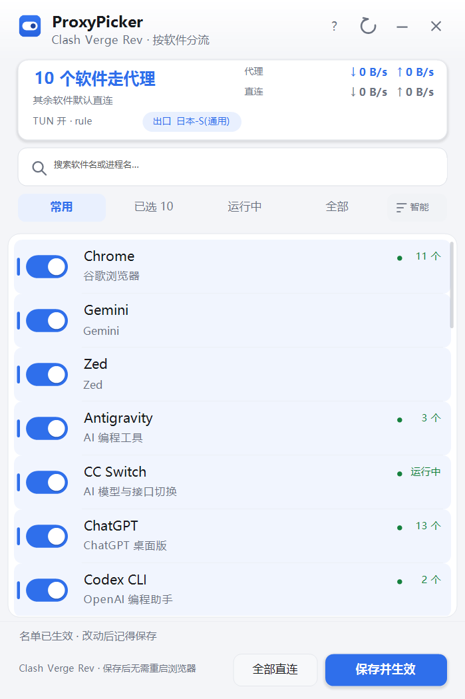
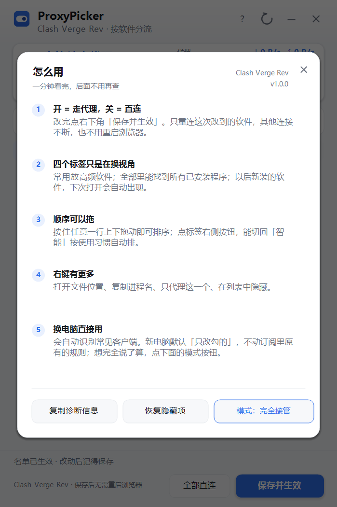

# ProxyPicker

只让「你勾选的软件」走代理 —— 一个给 Clash / mihomo 系客户端用的**按进程分流**小面板。

单文件 exe，1,021,464 字节（约 998 KB），不需要安装、不碰你的订阅。**默认不写注册表**；只有在你主动开启「开机自启」后，才会在当前用户的 `Run` 项里创建一条启动记录，关闭时删除，不需要管理员权限。

[**下载最新版**](https://github.com/wuerchenai-cell/ProxyPicker/releases/latest) ·
[直接下 exe](https://github.com/wuerchenai-cell/ProxyPicker/releases/latest/download/ProxyPicker.exe) ·
[更新记录](CHANGELOG.md)

> **最新版 v1.3.3**（2026-11-11 发布）：下载链接指向远端最新 Release，下载到的就是本版 exe。
> Release 页面：https://github.com/wuerchenai-cell/ProxyPicker/releases/tag/v1.3.3
> （v1.3.2 及更早版本的修复都已并入本版；v1.2.5 / v1.3.0 未单独发布。）
> v1.3.3 是四轮独立审查后的集中修复版：订阅兼容模式下看守不再把订阅自带的段首 MATCH
> 判成故障、白名单兜底 MATCH 变成硬约束、备份增加配置内容指纹（Verge 换订阅后不再推回旧快照）、
> 还原如实汇报接管状态清除结果、整条保存链共享同一份配置（含连接快照与定向重连）、
> 猜测端口不再发送密钥或执行写操作、通道缓存加锁、密钥解析只认顶层、
> 坏名单不再静默变成空名单、旧版清理不再凭软件名删文件，以及全部发布文档与哈希对齐。
> 离线自检 **171 项**（通用性 130 + 控制接口安全 32 + 流量对账 9）。
> 程序里的「检查更新」只在远端版本号比本机大时才提示，不会把人引去下载旧包。
> 切换客户端后请等几秒再保存：识别结果有 5 秒缓存，保存链路锁定的是这一次识别到的配置。



*界面截图摄于 v1.0.0：布局一致，按钮文字与默认模式说明以 v1.3.3 正文为准。*

---

## 它解决什么问题

Clash 的规则是按「域名 / IP / 规则集」写的，而人脑子里想的是「我要让 Chrome 走代理，微信别走」。
两者之间差的是一层翻译：**进程 → 规则**。

ProxyPicker 干的就是这件事。点几个开关，点保存，程序把 `PROCESS-NAME` 规则插到你内核配置的
`rules:` 段首，然后热推一次（`PUT /configs`）。全程不重启客户端、不断其他连接，
按软件的代理名单立刻生效。

---

## 特点

- **改完不用重启浏览器**：保存时只关闭「本次改动到的软件」的旧连接，其他连接（下载、长连接）不断。
- **两种分流模式，随时可切**（新机器默认代理白名单；已有配置不会被升级覆盖）
  | 模式 | 勾选的软件 | 没勾选的软件 | 适合谁 |
  |---|---|---|---|
  | 代理白名单（核心，新机器默认） | 走代理 | 一律直连 | 只想让少数软件出网 |
  | 订阅兼容（高级） | 走代理 | 继续按订阅原规则走 | 不想动订阅 / 老用户 |
- **自己发现 + 自己补回**：每 30 秒核对一次「我插的规则还在不在」（收进托盘也不停）。
  换订阅、重启客户端、改设置都会把规则冲掉，这时会自己补回去并留一句提示。
- **扫不到也能手动加**：自动发现只覆盖运行进程、已安装软件、内置清单和已保存名单，
  绿色版、MSIX、游戏目录、脚本类程序可能漏。托盘菜单「手动添加软件…」可手选 exe，
  加过一次会一直留在列表里；「全部」标签带总数，切过去或用搜索框就能找到。
- **还原就是真的还原**：托盘「还原上次保存前的配置」会清掉内核里的本工具规则并撤销接管状态，
  后台看守不会过几十秒又自动接管。整份旧备份只有在「来源路径与配置内容都没变」时才会推回；
  换过客户端、或订阅在同一路径被更新过（Clash Verge 常见），不会把旧备份整份推回去，
  而是按当前订阅重建一份干净配置，你自己的规则原样保留。名单文件删除失败时会明确告知，
  不会假装「接管状态已清除」。
- **不越权改全局设置**：IPv6 归客户端自己管（Clash Verge 新版把 `ipv6` 列为应用设置接管字段，
  外部再写会被丢弃并弹橙色警告），所以程序默认一个字都不碰。
  确需防泄漏时，可在帮助面板里主动打开「IPv6 防泄漏」：改前记下原值，关掉即恢复。
- **换电脑直接用**：自动识别 Clash Verge Rev / Clash Verge / Clash Nyanpasu / Mihomo Party /
  FlClash / Clash for Windows / 裸 mihomo。
- **多个客户端会选择运行中的那个**：不再按目录顺序拿第一份配置。按「内核命令行指向 >
  客户端进程 > 控制端口 > 配置更新时间」打分；`--diag` 会列出全部候选、得分和选择依据。
  两个同时在跑时仍建议只留一个。
- **看得见真实出口**：流量与出口一律以 mihomo 返回的 `chains`（实际链路）为准；
  用户勾选只代表「预期」。两者不一致会在摘要卡提示，并在「复制诊断」里逐条列出。
- **识别边界说得清**：同名 exe 来自不同目录会提示（勾一个会连带命中另一个），同目录的辅助进程
  （Electron helper、更新器）由安装目录规则自动覆盖，不用手动逐个勾；右键仍可查看完整路径、同名冲突和同目录进程，另有只读 `--scan` 排查命令。



---

## 快速开始

1. 打开右侧 **Releases**，下载最新的 `ProxyPicker-v1.x.x-share.zip`
   （分享包；只需要主程序的话单独下 `ProxyPicker.exe` 也行）；
2. 解压，双击 `ProxyPicker.exe`（右下角出现图标，面板自动弹出）；
3. 勾上要走代理的软件 → 点右下角「保存并生效」。

**前提**：这台电脑上本来就有 Clash Verge 之类的客户端、并且正在运行。
这个工具**不带代理**，它只决定「谁走代理」。

> 第一次运行可能被 Windows SmartScreen 拦一下（exe 用的是自签名证书，Windows 不认识这个发布者）：
> 点「更多信息」→「仍要运行」。源码全在这个仓库里，可以自己编译；签名说明见下文。

详细说明见 [docs/使用说明.md](docs/使用说明.md)。

---

## 常见问题

**Q：勾了还是不走代理？**
先看摘要卡右下角的规则数有没有变，再看底部状态是不是「名单已生效」。
如果客户端在你保存之后重新生成过配置，规则会被冲掉——等 30 秒它会自己补回，或者点一下右上角刷新。

**Q：怎么撤掉，回到原来的分流？**
可靠做法：托盘菜单「还原上次保存前的配置」，或直接点窗口「×」退出（会先还原配置再退出）。
这两条都会删掉接管名单，后台看守不再补回。
在 Clash Verge 里点「更新 / 应用」只会**暂时**冲掉规则：只要本程序还在运行、接管名单还在，
后台看守随后就会把规则补回来，不能当作永久退出方式。
彻底删干净：exe、`%LOCALAPPDATA%\ProxyPicker\`、客户端的 `pp_rules` 目录
（`pp_rules` 现在只在从很老的版本迁移名单时才会用到，新版本不写它）。

**Q：会把我的订阅传到网上吗？**
不会。程序只读本机配置文件和控制面接口，运行时唯一的对外请求是「检查更新」时发给 GitHub API 的一个 GET，
不带任何本机信息；把 `settings.json` 里的 `"updateCheck"` 改成 `false` 就完全不联网。

**Q：Clash Verge 弹「扩展配置或脚本写入了由应用设置接管的字段 ipv6，这些值已被丢弃」？**
这是客户端的提示，不是 ProxyPicker 报错。新版 Clash Verge 把 `ipv6` 收归自己的应用设置，
早期版本在 Merge 扩展里留下的 `ipv6: false` 会被它丢弃并弹橙色条。删掉 merge 文件里那一行即可；
ProxyPicker 现在默认完全不写这个字段。要真正开关 IPv6，请在 Clash Verge 设置界面里改。

**Q：支持 macOS / Linux 吗？**
不支持。命名管道、注册表开机自启、WinForms 自绘界面都是 Windows 专用。

---

## 从源码构建

需要 .NET SDK（能编译 `net48` 目标即可）和 Windows：

```bat
dotnet build src\ProxyPicker.csproj -c Release
```

产物：`src\bin\Release\net48\ProxyPicker.exe`（单文件，无外部依赖）。

只读自检出口（不改任何配置）：

```bat
ProxyPicker.exe --selftest 自检.txt     :: 通用性 130 项 + 控制接口安全 32 项 + 流量对账 9 项（共 171 项）
ProxyPicker.exe --dryrun 配置.yaml 输出.yaml whitelist
ProxyPicker.exe --scan 进程识别.txt     :: 只读列出路径、同名冲突、辅助进程（已脱敏）
ProxyPicker.exe --version 版本.txt
ProxyPicker.exe --checkupdate 更新.txt
ProxyPicker.exe --cleanlegacy 清理.txt  :: 只检测旧版 profile 注入，不清理
```

所有命令行开关都必须带输出文件路径；只敲 `--selftest` 会打印用法并返回非 0，不会再悄悄打开面板。
`--apply`、`--cleanlegacy --yes` 会真实修改客户端配置，必须加 `--yes` 确认；
`--raw` 默认只允许 GET/HEAD，非只读方法同样要 `--yes`：

```bat
ProxyPicker.exe --apply 结果.txt --yes   :: 按当前勾选名单推送规则；ok=False 时退出码非 0
```

其余开关（含 `--diag`、`--payload`、`--audit`、`--api`、`--raw`）都不写**磁盘配置**。
但 `--restore` 会调用退出还原，向运行中的内核推送一份干净配置 —— 它不改订阅文件，
却会改变内核当前的运行状态，诊断 / 排障环境里不要随手执行。

**关于数字签名**：v1.1.0 起 Release 的 exe 带 Authenticode 签名（SHA-256）。用的是自签名证书
`CN=ProxyPicker Development Signing`，指纹 `90361B0827F82D434A62CBEBE13D50ECB78D6CE8`，
公钥证书 `ProxyPicker-selfsigned.cer` 随包提供，可用 `Get-AuthenticodeSignature ProxyPicker.exe` 核对签名者指纹。

自签名只能证明「文件没被改过」，不能证明发布者身份：Windows SmartScreen **仍会**提示「未知发布者」
（点「更多信息」→「仍要运行」）。要彻底消除提示必须购买 OV / EV 代码签名证书，这一步需要证书机构实名与付费，
当前未做。每个 Release 都会公布**官方已签名附件**的 SHA-256 并对应固定的源码提交。
注意：从源码自行编译不会得到相同的文件 SHA-256 —— 发布 exe 带 Authenticode 签名与时间戳，
独立构建者没有同一私钥，签名数据也不可能一致。自行编译适合核对程序集内容与功能，
核对下载文件是否被动过请用公布的那个哈希。

---

## 目录

```
src/            C# 源码（net48，WinForms 自绘界面）
  Core/         发现客户端、读配置、生成规则、控制面通信、对账、偏好
  UI/           窗口、列表、托盘、主题、动效
  Assets/       ico（16/24/32/48/64/128/256 七帧 32 位）
docs/           使用说明与截图
```

---

## 许可

MIT，见 [LICENSE](LICENSE)。
